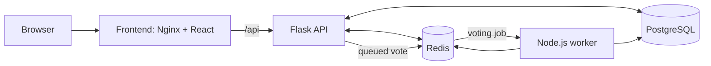
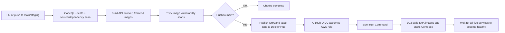

# Ballot

An election app built to demonstrate a production delivery pipeline on AWS.

[](https://github.com/Christos-Ops/Voting-app/actions/workflows/build-images.yml)
[](https://github.com/Christos-Ops/Voting-app/actions/workflows/build-images.yml)

Ballot is a small full-stack voting application with voter and administrator workflows. This repository's focus is the production CI/CD pipeline that builds, scans, publishes, and deploys it.

## DevOps highlights

- CodeQL analyzes Python and JavaScript/TypeScript with the `security-extended` query set on pull requests and supported branch pushes.
- Trivy scans source files and dependencies for vulnerabilities and secrets, then scans all three built images for high and critical vulnerabilities before publishing.
- Production deploys use images tagged with the source commit SHA, not the moving `latest` tag. The workflow also publishes `latest` as a convenience alias; registry-side tag immutability is not configured here.
- GitHub Actions obtains short-lived AWS credentials through GitHub OIDC. No long-lived AWS access key is configured in the deployment workflow; Docker Hub credentials are stored as GitHub secrets for publishing.
- The workflow sends deployments through AWS Systems Manager Run Command, with no SSH step.
- The deployment script installs Docker Engine and the Compose plugin from Docker's official Ubuntu apt repository when either is missing, then enables Docker.
- After starting the stack, the deploy script waits for PostgreSQL, Redis, API, worker, and frontend health checks before reporting success.
- Application secrets stay in `/opt/voting-app/.env` on EC2; deployment checks the file and sets its permissions without transferring or printing its contents. CloudWatch collects per-service logs and raises CPU and API/worker error alarms.

## Architecture



| Component | Responsibility |
| --- | --- |
| Frontend | React interface served by Nginx; proxies `/api` to the API in production. |
| API | Flask JSON API, JWT authentication, election rules, and admin CLI. |
| Worker | Consumes Redis jobs and writes accepted votes to PostgreSQL. |
| PostgreSQL | Stores users, elections, candidates, and votes with relational constraints. |
| Redis | Holds vote reservations, the job queue, processing recovery state, and election result cache. |

**Voting integrity**

- A vote is accepted only for an `ACTIVE` election while its start/end window is open; administrators activate and close elections explicitly.
- Redis reserves one submission per voter and election before queueing. PostgreSQL also enforces one vote per voter/election and that the candidate belongs to that election.
- The worker writes votes in a transaction, recovers jobs left in its processing list after restart, and invalidates only the affected election's results cache.
- Non-admins see results only after an election is closed. This is an application demonstration, not a claim of election-grade security or auditability.

## CI/CD pipeline



The regular workflow is [`.github/workflows/build-images.yml`](.github/workflows/build-images.yml). README-only changes are excluded by its path filter. The AWS OIDC identity test and CloudWatch setup are separate manually dispatched workflows.

| Job | What it does | When it runs |
| --- | --- | --- |
| `codeql` | Analyzes Python and JavaScript/TypeScript. | Pull requests and pushes to `main` or `staging`. |
| `checks` | Runs API/worker tests, builds the frontend, validates both Compose files, and scans source/dependencies with Trivy. | Pull requests and pushes to `main` or `staging`. |
| `build-and-publish` | Builds and scans the API, worker, and frontend images; pushes SHA and `latest` tags only on `main`. | Pull requests and pushes to `main` or `staging`; publishing only on a `main` push. |
| `deploy-production` | Assumes the AWS role through OIDC and deploys the pushed commit through SSM. | Pushes to `main`, after image build/scan/publish succeeds. |

On the instance, the deployment script:

1. Requires root and a non-empty `/opt/voting-app/.env`, then sets the file mode to `0600` without reading it into workflow output.
2. Installs Docker/Compose from Docker's Ubuntu repository if needed and starts the Docker service.
3. Downloads `docker-compose.prod.yml` from the exact repository commit being deployed.
4. Validates the Compose configuration, pulls the images tagged with that commit SHA, and starts the stack with `--remove-orphans`.
5. Polls the health state of `db`, `redis`, `api`, `worker`, and `frontend`; a failed health gate fails the deployment job but does not automatically roll back containers.

## Production stack

`compose.yaml` is the development stack; `docker-compose.prod.yml` is the deployment stack.

| Concern | Development | Production |
| --- | --- | --- |
| Application images | Builds locally from the Dockerfiles. | Pulls published API, worker, and frontend images by `IMAGE_TAG`; PostgreSQL and Redis use upstream images. |
| Data | Named PostgreSQL volume; Redis has no named data volume. | Named PostgreSQL and Redis volumes; Redis enables append-only persistence. These volumes are not backups. |
| Health checks | PostgreSQL and Redis only. | PostgreSQL, Redis, API, worker, and frontend. |
| Published ports | PostgreSQL `5432`, Redis `6379`, API `5000`, worker `3001`, frontend `8080`. | Frontend HTTP `80` only; API, worker, PostgreSQL, and Redis remain internal to the Compose network. |

## Design decisions

| Decision | Reason and trade-off |
| --- | --- |
| SSM instead of SSH | Uses managed Run Command for deployment and avoids an SSH key/port in the workflow; it depends on SSM connectivity and IAM setup. |
| OIDC instead of stored AWS keys | Exchanges a GitHub identity token for temporary AWS credentials; the trust policy and role permissions are configured outside this repository. |
| Instance-local `.env` | Keeps application secrets off GitHub Actions and SSM command payloads; secret rotation and backup remain operator responsibilities. |
| Commit SHA deployment tags | Makes each deployment reference a specific build rather than `latest`; Docker Hub immutability is not enforced by repository code. |
| Scan before publishing | CodeQL, Trivy source/dependency scans, and Trivy image scans must succeed before images can be pushed. |
| Separate production Compose file | Keeps local builds and published-image deployment settings distinct, including production health checks, persistence, and logging. |
| Health-gated deployment | Detects services that fail to become healthy; it does not provide rolling traffic shifts or automatic rollback. |
| CloudWatch logs and alarms | Provides per-service logs and limited CPU/error alerting without changing application code; metric and alarm coverage is narrow. |

## Run locally

With Docker Compose installed:

```sh
docker compose up --build
```

Open <http://localhost:8080>. The development Compose file also publishes API, PostgreSQL, and Redis ports for local use.

Run the tests and frontend build:

```sh
python -m pip install -r requirements.txt
python -m pytest -q
npm ci
npm run test:worker
cd frontend
npm ci
npm run build
```

The API tests use SQLite and a Redis test double; worker tests use Node's built-in test runner. CI currently uses Python 3.12 and Node.js 24.

<details>
<summary>Manual per-service setup</summary>

The manual path needs Python, Node.js, PostgreSQL, and Redis. Create a database and user, then set `DATABASE_URL`, `WORKER_DATABASE_URL`, `REDIS_URL`, and `JWT_SECRET_KEY` in the relevant shells; `.env.example` is a reference and is not loaded automatically. Install the root and frontend dependencies with `python -m pip install -r requirements.txt`, `npm ci`, and `npm ci` from `frontend/`.

Start Flask after applying migrations, then create an administrator when prompted:

```sh
python -m flask --app app db upgrade
python -m flask --app app create-admin <ADMIN_EMAIL>
python -m flask --app app run --port 5000
```

In another terminal, start the worker with `WORKER_DATABASE_URL` and `REDIS_URL` set:

```sh
npm run start:worker
```

In a third terminal, start the Vite frontend from `frontend/`; its `/api` proxy targets `http://127.0.0.1:5000`:

```sh
npm run dev
```

</details>

## Reference docs

- [Production operations](docs/operations.md)
- [API, roles, workflows, and environment variables](docs/api.md)

## Roadmap and known limitations

- No automatic rollback, deployment concurrency group, or production approval gate is configured.
- There is no infrastructure-as-code definition in the repository. The IAM role policy and trust conditions are external, so least privilege cannot be verified from this codebase.
- Production publishes plain HTTP on port 80; HTTPS and TLS termination are not configured here.
- No database backup/restore automation or migration rollback is provided. The legacy election migration is intentionally irreversible.
- Application secrets are not stored in Secrets Manager; they remain in the EC2 `.env` file.
- CloudWatch alarm coverage is limited to EC2 CPU and API/worker error logs. Memory/disk metrics are collected by the agent, but no alarms for them are created by the setup workflow.
- Voting safeguards are application/database controls, not cryptographic verification, independent audit logging, or a formal election-security system.
